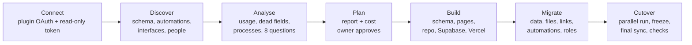

# airtable-exit

Move your company off Airtable onto its own CRM: Next.js on Vercel, Supabase (Postgres, Auth, Storage), code in your GitHub.
Claude Code reads your base (tables, formulas, automations, interfaces, people, usage), writes a plan you approve, then builds, deploys and migrates it.
One install, one command. Free and open source (MIT), by [lowcoding.dev](https://lowcoding.dev).


## How it works



Every step writes to a knowledge base in your repo (`kb/`). The next step reads it. Nothing is built before you approve the plan.

## Install

```text
/plugin marketplace add lowcoding-dev/airtable-exit
/plugin install airtable-exit@lowcoding-airtable
```

Then, in an empty folder: `/airtable-exit:setup`. It is resumable: run it again and it continues where it stopped.

## What setup does

1. Checks your tools (Node 20.11+, git, `gh`, `supabase`, `vercel`) and installs what is missing.
2. Walks you through three browser logins: GitHub, Supabase, Vercel.
3. Creates the project folder: the app template plus the project kit (skills, `CLAUDE.md`, `kb/`, hooks).
4. Connects Airtable. Discovery uses the official Airtable plugin (`airtable@claude-plugins-official`, one OAuth click). The data copy uses a read-only personal access token you paste into `.env.local`.
5. Reads the base and analyses how it is used.
6. Maps your processes and asks you at most 8 questions.
7. Writes the discovery report (`kb/report.md` and `docs/report.html`) and waits for your approval.
8. Creates a private GitHub repo, a Supabase project with migrations, and a Vercel deploy.
9. Invites you as admin and schedules the weekly health check.
10. Shows the live URL and the next steps.

Keys go to `.env.local` (gitignored) and Vercel env. Never into the knowledge base, a commit or the chat.

## What the agent reads by itself, and what it asks you

| Reads automatically (read-only) | Asks you |
|---|---|
| Bases, tables, fields with types, options and formula text | Which bases move, and the cutover date |
| Views (names, types, visible fields), record counts, attachment sizes | Screenshots of Interface pages and key views (filters, sorts, groups are not in the API) |
| Collaborators and permission levels (all plans), interfaces and who can open them | Script code from automations and the Scripting extension |
| Automations with triggers and steps (Airtable MCP), connected accounts, extensions, webhooks | Other tools that touch the base (Zapier, Make, forms on your site) |
| Fill rate per field, records per month, recent edits, duplicates, who edits where | Who your outside users are and what they should see |
| Seats with no recorded activity, API budget for the copy | Which reports matter, what hurts most, when the team can pause for the freeze |

Sources: Airtable Web API and MCP docs, read 2026-11-08. The MCP reads automations since the 2026-07-24 update.

## What it costs to run

| | Per month | Source (2026-11-08) |
|---|---|---|
| Airtable Team | $20/seat annual, $24 monthly | airtable.com/pricing |
| Airtable Business | $45/seat annual, $54 monthly | airtable.com/pricing |
| Supabase Pro | from $25 per project | supabase.com/pricing |
| Vercel Pro | $20 per developer seat, viewers free | vercel.com/pricing |

Example: 8 editors on Airtable Business, monthly billing = 8 × $54 = $432/month. After: $25 + $20 = $45/month before usage and email. Your report does this math with your own seat counts.
Supabase Free pauses idle projects and caps files at 50 MB. Vercel Hobby is for non-commercial use only. A company app needs both Pro plans.

## Requirements

- Claude Code with plugin support. A paid Claude plan if you want the weekly cloud health check.
- Node 20.11 or newer, git, GitHub CLI, Supabase CLI, Vercel CLI (setup installs the CLIs).
- Owner or creator access to the Airtable base. On Enterprise Scale, an admin may need to allow the Airtable MCP or Claude Code's OAuth client.

## Skills

The plugin carries only `setup`. Everything else is copied into your repo, so it also works in cloud sessions and scheduled tasks, where plugins don't load.

| Skill | When it runs | Writes |
|---|---|---|
| `/airtable-exit:setup` | You start it | the whole project, `kb/setup-state.md` |
| `discover` | "What's in our Airtable?" | `kb/airtable/inventory.md`, `inventory.json` |
| `usage-analysis` | "What do we actually use?" | `kb/airtable/usage.md` |
| `process-map` | "How do we work?" (asks ≤ 8 questions) | `kb/processes.md`, `kb/context.md` |
| `plan` | "Plan it", "what will it cost?" | `kb/plan.md`, `kb/report.md`, `docs/report.html` |
| `schema-designer` | "Design the tables", "add a field" | `app.schema.json`, `supabase/migrations/`, `kb/schema.md` |
| `app-builder` | "Build the dashboard", "add a view" | `app.schema.json`, pages |
| `data-migrator` | You start it | Supabase rows, files, parity report |
| `automations-rebuilder` | "Rebuild our automations" | `lib/automations/`, `kb/automations.md` |
| `roles-and-access` | "Invite the team", "clients see only theirs" | invites, RLS, `kb/access.md` |
| `sync-and-cutover` | You start it | `kb/cutover.md` |
| `health` | Weekly, scheduled | `kb/runs/` |
| `kb-keeper`, `kb-tidy` | "Remember…", weekly tidy | `kb/` |

Skills that change data or deploy (`setup`, `data-migrator`, `sync-and-cutover`) only run when you type them.

## The app you get

A config-driven CRM. `app.schema.json` describes tables, fields, views, forms, dashboards and roles, and the app renders them:
grid (sticky header, sorting, filters, inline edit, paging past 1,000 rows), kanban (drag to change stage), calendar, record pages (fields, links both ways, files, comments, activity), forms (internal and public) and dashboards (tiles and charts).
It runs without Supabase in demo mode: `cd template && npm install && npm run demo`.

| Kanban | Record | Dashboard | Phone |
|---|---|---|---|
|  |  |  |  |

Built in: magic-link sign-in for invited people only, roles mirrored in Postgres row-level security on every table, an Airtable formula parser that turns same-row formulas into generated columns, an idempotent copy (snapshot, typed upsert, attachments to Storage, links in a second pass), a parity check, nightly delta sync for the parallel run, and an automation runner with a run log.

## Scheduled runs

| What | Where | When |
|---|---|---|
| Weekly health check (`/health`) | Claude Code scheduled task on your repo, or the included GitHub Action | Weekly |
| Nightly Airtable delta sync | Vercel cron `/api/cron/sync` | Nightly, only during the parallel run (`SYNC_ENABLED=1`) |
| Rebuilt automations | Vercel cron `/api/cron/<job>` | Their schedules, only after cutover (`AUTOMATIONS_ENABLED=1`) |

## The knowledge base

Your repo gets a `kb/` folder that is the project's memory, with rules in `kb/RULES.md`:
every skill reads `kb/README.md` and `kb/context.md` first and writes what it learned (decisions, findings, run logs) in the same session.
Numbers carry a label: measured, sourced, stated, assumed or needs input. No secrets and no personal data: schema and counts only. People lists for invites stay in a gitignored `.migrate/` folder.
A session-start hook prints the map, the latest decisions and any open setup steps, so a new session starts from what the project already knows.

## Limits and gaps

- **View filters, sorts and groups are not in Airtable's API.** The agent asks for screenshots and rebuilds them. NocoDB and Baserow imports can bring them across through a share link, if you need a reference.
- **Rollup functions are not exposed.** The agent guesses (SUM for numbers, else COUNT), flags each one, and parity checks compare values.
- **Lookup filters, sorts and limits are not exposed either.**
- **Zapier, Make and other polling tools leave no trace in the API.** You confirm the list. Anything that stores Airtable record ids breaks at cutover and needs repointing.
- **Script code** from automations may not come back over MCP, and Scripting extension code never does. You paste it.
- **Revision history** is Enterprise-only. The migration moves current data and comments, not history.
- **Interfaces** become dashboard pages from your screenshots. Complex layouts need custom pages.
- **API limits:** 5 requests/s per base. Team plans have 100,000 calls per month, and MCP calls count too. The report checks the budget before the copy.
- **Not tested against a live Airtable account yet.** The copy and inventory code is unit-tested with fakes and the SQL is tested on Postgres. Your first run is the first live one, which is why it starts read-only and asks before writing.

## FAQ

**Does it change anything in Airtable?** No. Every Airtable call is a read. You turn off Airtable automations and make the base read-only yourself at cutover, from a checklist.

**What if setup stops halfway?** Run `/airtable-exit:setup` again. `kb/setup-state.md` keeps the checklist.

**Can I use it without the plugin?** Yes. Clone this repo and run `bash scripts/scaffold.sh my-crm`, then follow `skills/setup/SKILL.md` by hand.

**My company blocks the Airtable plugin.** Use the hosted MCP with your token: `claude mcp add --transport http airtable https://mcp.airtable.com/mcp --header "Authorization: Bearer $AIRTABLE_PAT"`.

**Several bases?** Run discovery per base. The schema step maps one base at a time. Synced tables between bases are flagged in the mapping notes.

**Who owns the result?** You. Your GitHub, your Supabase, your Vercel. No lock-in, MIT licence.

**What does the template's demo data contain?** An invented agency CRM. No real names; emails use example.com.

## Repo layout

```
.claude-plugin/        marketplace.json, plugin.json
hooks/, scripts/       SessionStart hook, scaffold.sh
skills/setup/          the one plugin skill + checklist and interview notes
kit/                   copied into your repo: CLAUDE.md, kb/, .claude/ (skills, hooks, settings), .github/
template/              the Next.js + Supabase app, migrations, scripts, tests
docs/screenshots/      UI at 1280 and 390 px
```

Want it done for you, with your automations and integrations? [lowcoding.dev](https://lowcoding.dev). Working version in a week, pay only if you're happy.
