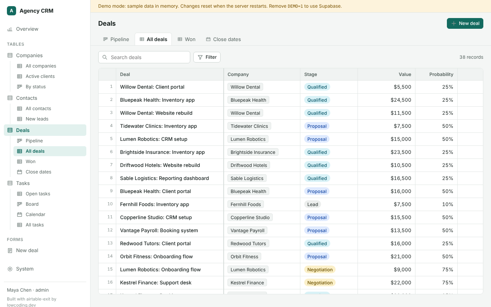
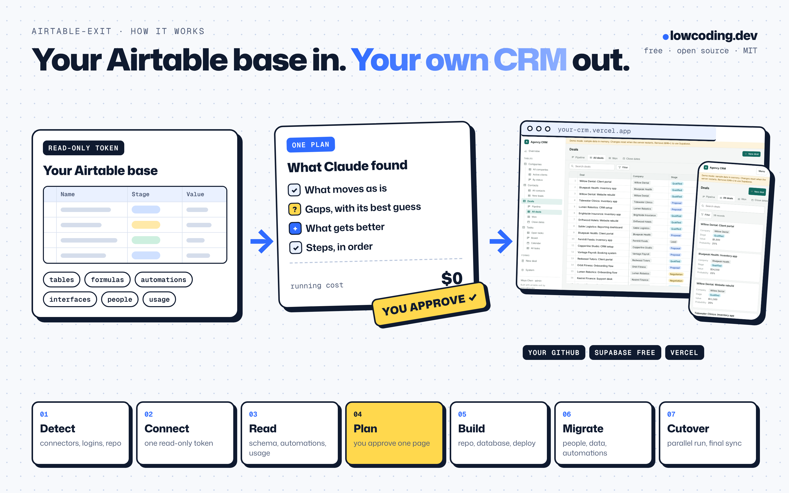
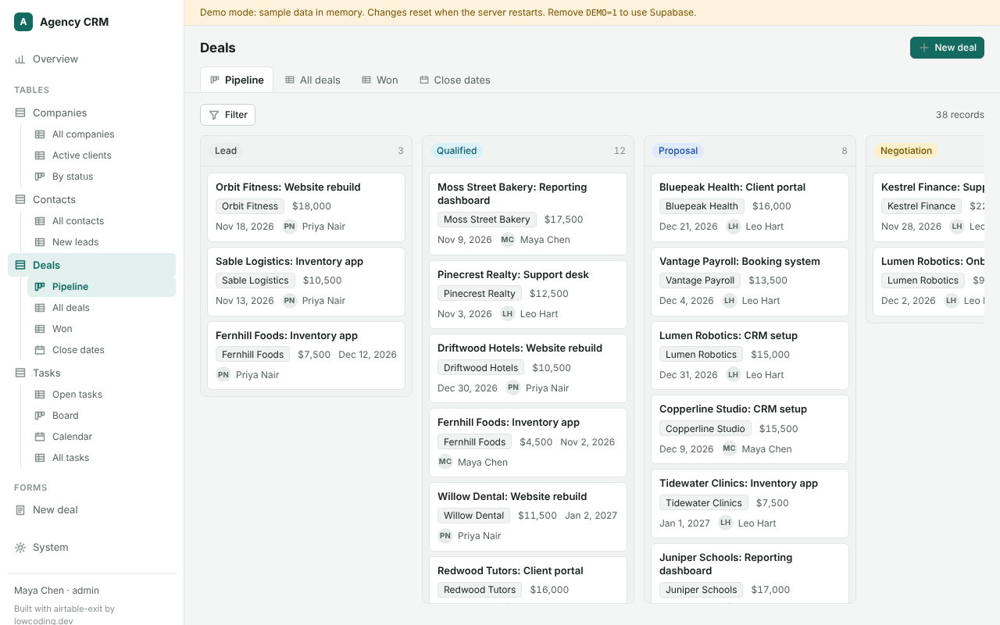
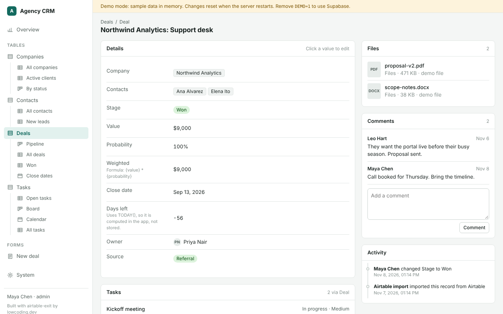
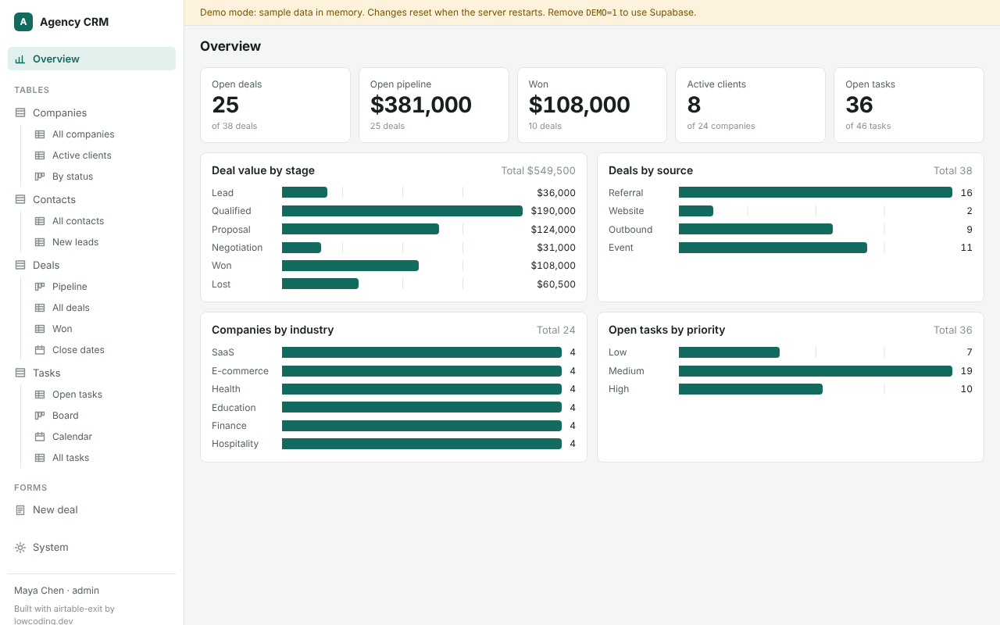
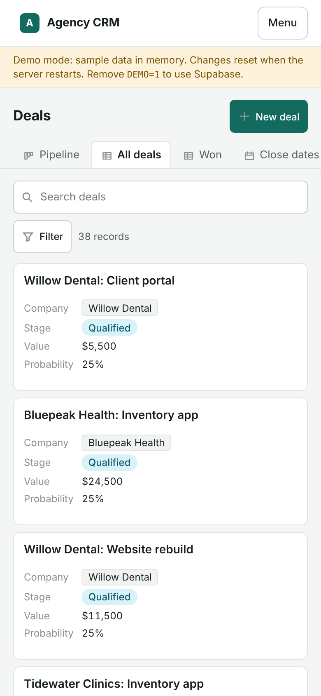

# airtable-exit

Move your company off Airtable onto its own CRM: Next.js on Vercel, Supabase (Postgres, Auth, Storage), code in your GitHub.
Claude Code reads your base (tables, formulas, automations, interfaces, people, usage), shows you one plan to approve, then builds, deploys and migrates it on free hosting plans.
One install, one command, almost no questions. The bundle is free and open source (MIT), by [lowcoding.dev](https://lowcoding.dev).
**You need a paid Claude plan** (Pro, Max, Team or Enterprise) **or Anthropic API credits to run it**: the free
claude.ai plan does not include Claude Code.



## How it works



You answer very little. Claude reads what it can, does what is clear, and shows you **one plan**: what it found, what
moves as is, what is missing or unclear (with its best guess and what it will do), and what the new app can do
better. You approve it or comment on any line. Screenshots or script code are optional "better with" suggestions in
the plan, never a question round. Nothing is created outside your project folder before you approve.

Every step writes to a knowledge base in your repo (`kb/`). The next step reads it.

## Install

**Claude Code on your computer:**
```text
/plugin marketplace add hichock/airtable-exit
/plugin install airtable-exit@lowcoding-airtable
```
Then, in an empty folder: `/airtable-exit:setup`. It is resumable: run it again and it continues where it stopped.

**Claude Code in the cloud (claude.ai/code):** start a session on an empty private repo and type
`Set up airtable-exit from github.com/hichock/airtable-exit`. A cloud session cannot create repos, so the repo you
pick is the project's home. If it already has files, setup asks once whether to use a `crm/` folder or a new repo.

**Without the plugin:** clone this repo and run `bash scripts/scaffold.sh my-crm`, then follow `skills/setup/SKILL.md`.

## What setup does

1. **Detects** where it runs (cloud session or your computer), which connectors are on (Supabase, Vercel, GitHub,
   Airtable), which tools are installed and logged in, and which keys are already set. It asks for nothing it can
   find out.
2. **Picks the project folder**: the attached repo in a cloud session (asks only if it has other files), or a new
   folder on your computer.
3. **Connects Airtable read-only.** One token you create in 2 minutes (guide included). It also reads automations
   and interfaces through Airtable's MCP. The official Airtable plugin is optional.
4. **Reads everything** by itself: schema, formulas, automations, interfaces, people, usage, dead fields, processes.
5. **Shows one plan** (`kb/report.md` and `docs/report.html`) and waits for your yes.
6. **Builds** in your accounts, on free hosting plans: private GitHub repo, Supabase project with migrations, Vercel deploy.
   It prefers connectors when they are on and falls back to command-line tools or a dashboard guide.
7. **Sets up sign-in emails** (live URL in Supabase, and an email service so invites reach people outside your
   Supabase account; Resend's free plan by default), **invites you** as admin, schedules the weekly health check, and shows the live URL and the next steps.

Step-by-step guides for every click you might need (Airtable token, Supabase keys, Vercel environment variables,
GitHub, cloud sessions): [`skills/setup/references/guides/`](skills/setup/references/guides/).
Keys go to `.env.local` (gitignored), the cloud environment's settings and Vercel env. Never into the knowledge
base, a commit or the chat.

## What the agent reads by itself, and what stays a guess

| Reads automatically (read-only) | Best guess in the plan, better with your input |
|---|---|
| Bases, tables, fields with types, options and formula text | View filters, sorts and groups (guessed from view names; a screenshot makes them exact) |
| Views (names, types, visible fields), record counts, attachment sizes, largest file | Interface page layouts (one dashboard per interface; a screenshot makes it match) |
| Collaborators and permission levels (all plans), interfaces and who can open them | Script code in automations, if the MCP does not return it (paste it to get it ported) |
| Automations with triggers and steps (Airtable MCP), connected accounts, extensions, webhooks | Other tools that touch the base (Zapier, Make, website forms): listed as seen or possible |
| Fill rate per field, records per month, recent edits, duplicates, who edits where | Outside users (interface-only users become the portal role) |
| Seats with no recorded activity, API budget for the copy | Cutover date (proposed from your quietest day) |

Sources: Airtable Web API and MCP docs, read 2026-11-08. The MCP reads automations since the 2026-07-24 update.
The kit blocks the Airtable MCP's create, update and delete tools in `.claude/settings.json`, so the agent can only read.

## What it costs to run

Hosting is free by default: Supabase Free, Vercel Hobby, GitHub Free and Resend Free cost $0 and fit most small
CRMs. Claude Code itself is not free: it runs on your paid Claude plan or API usage.

| | Per month | Limits that matter | Source (2026-11-09) |
|---|---|---|---|
| Supabase Free | $0 | 500 MB database, 1 GB files, **50 MB per file**, pauses after 1 week idle | supabase.com/pricing |
| Vercel Hobby | $0 | Daily crons (the app's are daily), 5-minute functions | vercel.com/docs/plans/hobby |
| GitHub Free | $0 | Private repos included | github.com/pricing |
| Resend Free (invite and sign-in emails) | $0 | 3,000 emails a month, 100 a day; needs a domain you can add DNS records to | resend.com/pricing (2026-11-12) |
| Claude Code | your Claude plan | Pro, Max, Team or Enterprise subscription, or API usage; not in the free plan | code.claude.com/docs/en/setup (2026-11-12), prices at claude.com/pricing |
| Airtable Team (today) | $20/seat annual, $24 monthly | | airtable.com/pricing (2026-11-08) |
| Airtable Business (today) | $45/seat annual, $54 monthly | | airtable.com/pricing (2026-11-08) |

Example: 8 editors on Airtable Business, monthly billing = 8 × $54 = $432/month. After: $0/month for hosting on the free tiers,
before email sending. Your plan does this math with your own seat counts.

**Files over 50 MB:** the copy skips them and lists them. Keep them where you already store big files (Google Drive,
Dropbox, SharePoint) and put the link in the record, or upgrade Supabase then (Pro from $25/month, files up to
500 GB). Same choice if all files together pass 1 GB.
**Paid plans are an option, not a requirement:** Supabase Pro ($25/month) adds daily backups and no pausing;
Vercel Pro ($20 per developer seat) adds frequent crons. Vercel's fair-use guidelines describe Hobby as
non-commercial, personal use; the plan mentions it and you decide.

## Requirements

- **A paid Claude plan or API credits.** Claude Code needs a Pro, Max, Team or Enterprise plan, or an Anthropic
  Console (API) account billed per use; the free claude.ai plan does not include it (sourced:
  code.claude.com/docs/en/setup, read 2026-11-12). The weekly cloud health check runs on the same plan.
- Claude Code itself: on your computer with plugin support, or in the cloud at claude.ai/code.
- Free accounts at GitHub, Supabase and Vercel. Connectors for them in claude.ai make it easiest; otherwise setup
  uses their command-line tools (it installs them) or walks you through the dashboard.
- For invites to your team: a free Resend account (or another email service) and a domain you can add DNS records
  to. Supabase's built-in email only reaches members of your Supabase organization, 2 emails an hour (Supabase docs,
  read 2026-11-12). Setup walks you through it ([guide](skills/setup/references/guides/supabase.md), "Email").
- Owner or creator access to the Airtable base. On Enterprise Scale, an admin may need to allow the Airtable MCP or
  Claude Code's OAuth client.

## Help

Stuck, or a question? Say "help" in Claude Code. The `get-help` skill writes a short summary of the problem
(no keys, no other people's data), checks with you that your contact details are current, and sends it to the
author of this bundle. A person answers, usually within one working day. You can also email info@lowcoding.dev.

## Skills

The plugin carries only `setup`. Everything else is copied into your repo, so it also works in cloud sessions and
scheduled tasks, where plugins don't load.

| Skill | When it runs | Writes |
|---|---|---|
| `/airtable-exit:setup` | You start it | the whole project, `kb/setup-state.md` |
| `discover` | "What's in our Airtable?" | `kb/airtable/inventory.md`, `inventory.json` |
| `usage-analysis` | "What do we actually use?" | `kb/airtable/usage.md` |
| `process-map` | "How do we work?" (asks nothing, lists gaps with guesses) | `kb/processes.md` |
| `plan` | "Plan it", "what will it cost?" (one approval) | `kb/plan.md`, `kb/report.md`, `docs/report.html` |
| `schema-designer` | "Design the tables", "add a field" | `app.schema.json`, `supabase/migrations/`, `kb/schema.md` |
| `app-builder` | "Build the dashboard", "add a view" | `app.schema.json`, pages |
| `roles-and-access` | "Invite the team" (before the data copy) | invites, RLS, `kb/access.md` |
| `data-migrator` | You start it | Supabase rows, files, parity report |
| `automations-rebuilder` | "Rebuild our automations" | `lib/automations/`, `kb/automations.md` |
| `sync-and-cutover` | You start it | `kb/cutover.md` |
| `health` | Weekly, scheduled | `kb/runs/` |
| `get-help` | "Help", "I'm stuck" | a request to the author, `kb/runs/` |
| `kb-keeper`, `kb-tidy` | "Remember…", weekly tidy | `kb/` |

Skills that change data or deploy (`setup`, `data-migrator`, `sync-and-cutover`) only run when you type them.

## Testing it yourself

[TESTING.md](TESTING.md): a full run with free accounts and an Airtable template base, and a dry run on demo data
that needs no accounts.

## The app you get

A config-driven CRM. `app.schema.json` describes tables, fields, views, forms, dashboards and roles, and the app renders them:
grid (sticky header, sorting, filters, inline edit, paging past 1,000 rows), kanban (drag to change stage), calendar, record pages (fields, links both ways, files, comments, activity), forms (internal and public) and dashboards (tiles and charts).
It runs without Supabase in demo mode: `cd template && npm install && npm run demo`.

| Kanban | Record | Dashboard | Phone |
|---|---|---|---|
|  |  |  |  |

Built in: magic-link sign-in for invited people only, roles mirrored in Postgres row-level security on every table, an Airtable formula parser that turns same-row formulas into generated columns, an idempotent copy (snapshot, typed upsert, attachments to Storage, links in a second pass), a parity check, nightly delta sync for the parallel run, and an automation runner with a run log.

## Scheduled runs

| What | Where | When |
|---|---|---|
| Weekly health check (`/health`) | Claude Code scheduled task on your repo, or the included GitHub Action | Weekly |
| Nightly Airtable delta sync | Vercel cron `/api/cron/sync` | Nightly, only during the parallel run (`SYNC_ENABLED=1`) |
| Rebuilt automations | Vercel cron `/api/cron/<job>` | Their schedules, only after cutover (`AUTOMATIONS_ENABLED=1`) |

## The knowledge base

Your repo gets a `kb/` folder that is the project's memory, with rules in `kb/RULES.md`:
every skill reads `kb/README.md` and `kb/context.md` first and writes what it learned (decisions, findings, run logs) in the same session.
Numbers carry a label: measured, sourced, stated, assumed or needs input. No secrets and no personal data: schema and counts only. People lists for invites stay in a gitignored `.migrate/` folder.
A session-start hook prints the map, the latest decisions and any open setup steps, so a new session starts from what the project already knows.

## Limits and gaps

- **View filters, sorts and groups are not in Airtable's API.** The agent guesses them from view names and flags each guess; a screenshot makes them exact. NocoDB and Baserow imports can bring them across through a share link, if you need a reference.
- **Rollup functions are not exposed.** The agent guesses (SUM for numbers, else COUNT), flags each one, and parity checks compare values.
- **Lookup filters, sorts and limits are not exposed either.**
- **Zapier, Make and other polling tools leave no trace in the API.** The plan lists what it can see; you add the rest when you like. Anything that stores Airtable record ids breaks at cutover and needs repointing.
- **Script code** from automations may not come back over MCP, and Scripting extension code never does. Paste it if you want it ported.
- **Deletes during the parallel run** are not synced nightly (the sync only adds and updates). The parity check lists rows deleted in Airtable, and you decide at cutover.
- **Files over 50 MB** are not copied on Supabase Free. They are listed with their record so you can link them.
- **Revision history** is Enterprise-only. The migration moves current data and comments, not history.
- **Interfaces** become dashboard pages, matched to your screenshots if you send them. Complex layouts need custom pages.
- **API limits:** 5 requests/s per base. Team plans have 100,000 calls per month, and MCP calls count too. The report checks the budget before the copy.
- **Not tested against a live Airtable account yet.** The copy and inventory code is unit-tested with fakes and the SQL is tested on Postgres. Your first run is the first live one, which is why it starts read-only and asks before writing.

## FAQ

**Does it change anything in Airtable?** No. Every Airtable call is a read. You turn off Airtable automations and make the base read-only yourself at cutover, from a checklist.

**What if setup stops halfway?** Run `/airtable-exit:setup` again (or say "continue setup" in a cloud session). `kb/setup-state.md` keeps the checklist.

**Can I use it without the plugin?** Yes. Clone this repo and run `bash scripts/scaffold.sh my-crm`, then follow `skills/setup/SKILL.md` by hand.

**Do I need the Airtable plugin?** No. One read-only token covers the REST reads, the copy and, through Airtable's MCP command-line tool, the automations. The plugin is optional.

**Is it really free?** The hosting is, for most small CRMs. Claude Code is not: it needs a paid Claude plan or API usage. The plan checks your real numbers against the free limits (files, storage, database size) and tells you which limit, if any, you would hit.

**Who do I ask when something breaks?** Say "help" in Claude Code, or email info@lowcoding.dev.

**Several bases?** Run discovery per base. The schema step maps one base at a time. Synced tables between bases are flagged in the mapping notes.

**Who owns the result?** You. Your GitHub, your Supabase, your Vercel. No lock-in, MIT licence.

**What does the template's demo data contain?** An invented agency CRM. No real names; emails use example.com.

## Repo layout

```
.claude-plugin/        marketplace.json, plugin.json
hooks/, scripts/       SessionStart hook, scaffold.sh
TESTING.md             how to test the bundle end to end, or as a dry run
skills/setup/          the one plugin skill + checklist, detection rules, questions policy, guides/
kit/                   copied into your repo: CLAUDE.md, kb/, .claude/ (skills, hooks, settings), .github/
template/              the Next.js + Supabase app, migrations, scripts, tests
docs/screenshots/      UI at 1280 and 390 px
```

Want it done for you, with your automations and integrations? [lowcoding.dev](https://lowcoding.dev). Working version in a week, pay only if you're happy.
